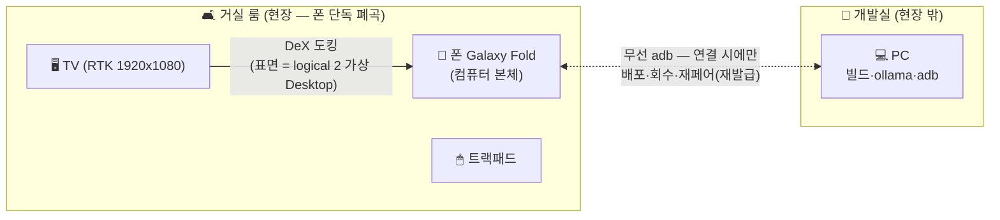
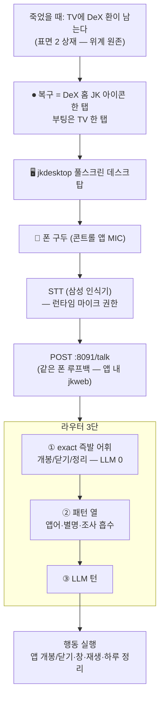
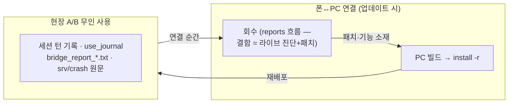
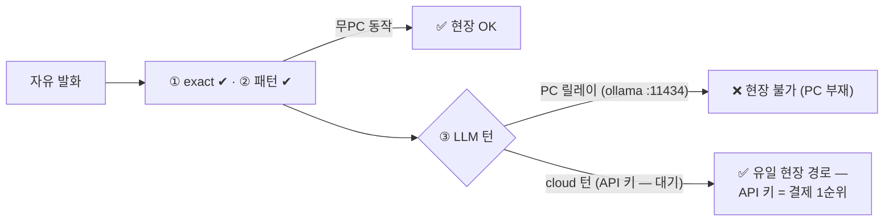

# 105a — 사용 환경·시나리오 인포그래픽 (2026-11-08)

본체 원장 = docs/105_usage_environment_scenario.md. 시각 요약 — 본체 원장의
시각 부록(mermaid — GitHub/뷰어 렌더 전제).

## 1. 물리 토폴로지

## 2. 시나리오 A — 거실 구두 제어 (사이클)

## 3. 시나리오 B/C — 폰 단독 + 개발 사이클 (사용 기록 폐곡 루프)

## 4. 자연어 갭 — 턴 축별 현장 동작

