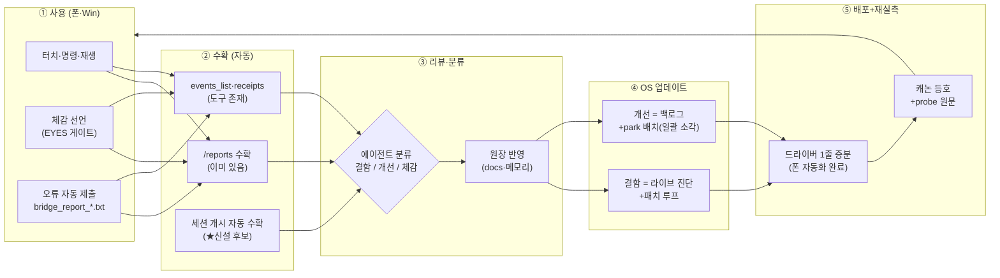
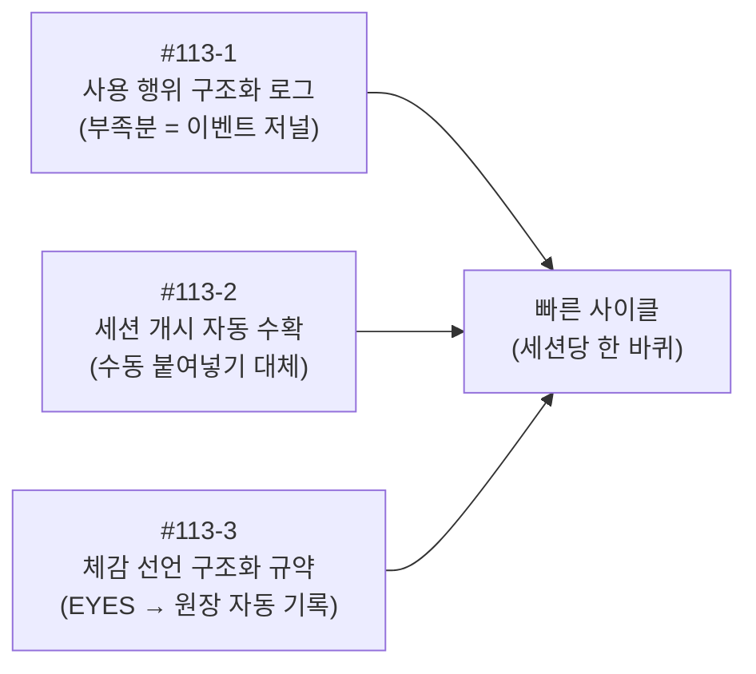
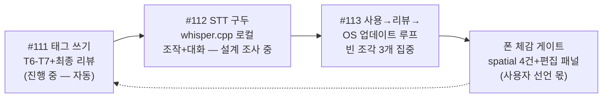

# 사용→리뷰→OS 업데이트 사이클 지도 (윤곽 확정 전 공개 초안 — 2026-10-25)

> 3축 지도 + 사이클 흐름. mermaid — GitHub/호환 뷰어에서 렌더. 원장: 대화 2026-10-25
> (사용자 지시 "사용 내용을 그대로 가져와서 리뷰를 거쳐 OS를 업데이트하는 사이클").

## 1. 사이클 한 바퀴 (목표형 — 세션당/당일 단위)

## 2. 빠진 조각 3개 (진짜 공사 부분)

## 3. 라인 순서 (방향 확정 — 2026-10-25)

- **A축(앱 폴리싱)=최소 증분** — deferred minor는 batch park 겸행 소각.
- **C축(STT 구두+사이클)=주축** — 사용자 그림(DeX+구두 OS) 수렴.
- 좌표 재보정·폰 X 서계 등 원장행 = 사이클 ④단계(업데이트)의 결함 후보급으로 순환 소각.