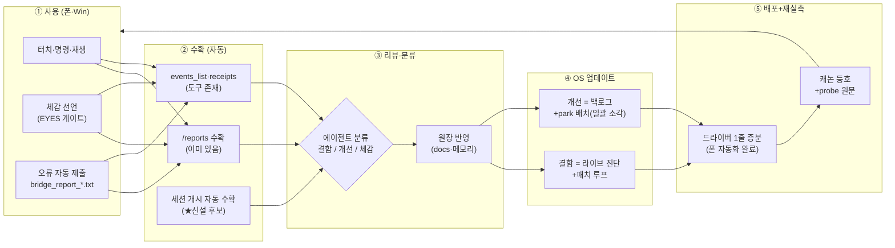
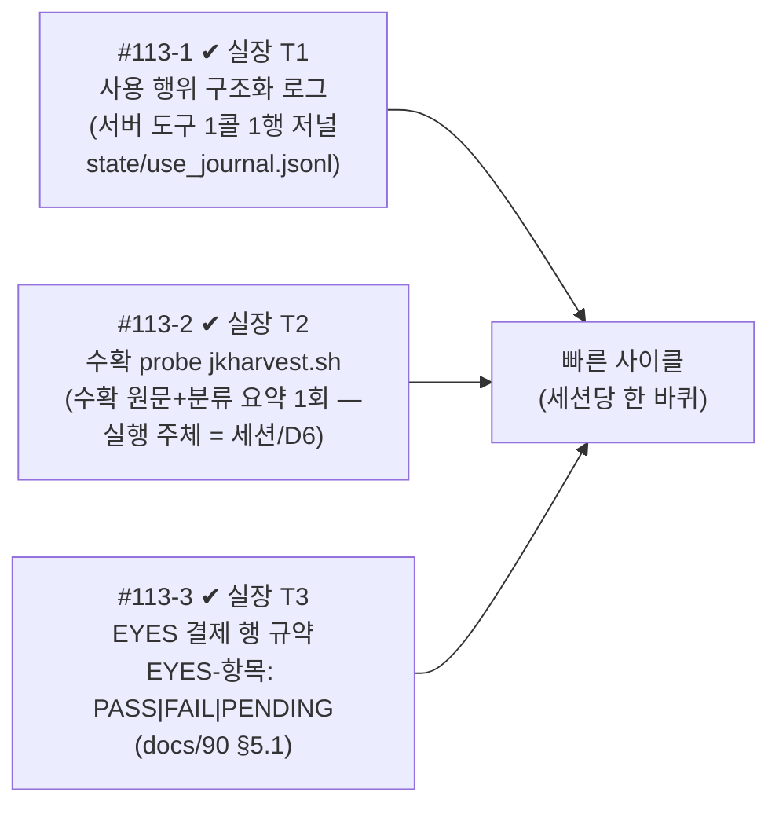
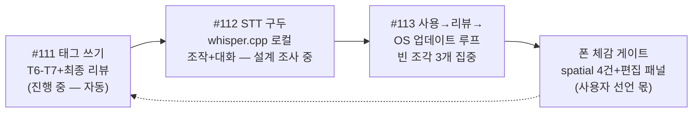

# 사용→리뷰→OS 업데이트 사이클 지도 (윤곽 확정 전 공개 초안 — 2026-10-25)

> 3축 지도 + 사이클 흐름. mermaid — GitHub/호환 뷰어에서 렌더. 원장: 대화 2026-10-25
> (사용자 지시 "사용 내용을 그대로 가져와서 리뷰를 거쳐 OS를 업데이트하는 사이클").

## 1. 사이클 한 바퀴 (목표형 — 세션당/당일 단위)

## 2. 빠진 조각 3개 (진짜 공사 부분 — ①②③ 실장 완료 #113 T1-T3, 2026-10-26)

실장 부기(2026-10-26 — 1-3행 원칙):
- **#113-1 = T1(1e52392)** — `JKWindowServer::HandleAgentQuery` 도구 사슬 말미
  훅 1곳(DRY)·append-only JSONL·쓰기 실패 = 조용히 스킵(도구 무영향 — D1/D5).
- **#113-2 = T2(2fa0224·fix r2 5fce208)** — 수확 probe `jkharvest.sh`: 저널
  파일 직독+bridge_report 목록+분류 요약+`HARVEST-VERDICT` 1행 — Win/WSL/폰
  공통(폰 = OBSERVE 읽기 접점만)·**세션 개시의 "자동" 실행도 D6에 따라 세션(
  Claude)이 수행** — v1 = 수확+분류만 자동, 조치(배치)는 세션 수행 유지.
- **#113-3 = T3(본 문서+docs/90 §5.1)** — 결제 행 형식 규약·사용자 선언만
  결제 원칙 불변(형식만 규약 — 도구/선언 구분은 §5.1 표 3치 PASS|FAIL|PENDING).

## 3. 라인 순서 (방향 확정 — 2026-10-25)

- **A축(앱 폴리싱)=최소 증분** — deferred minor는 batch park 겸행 소각.
- **C축(STT 구두+사이클)=주축** — 사용자 그림(DeX+구두 OS) 수렴.
- 좌표 재보정·폰 X 서계 등 원장행 = 사이클 ④단계(업데이트)의 결함 후보급으로 순환 소각.