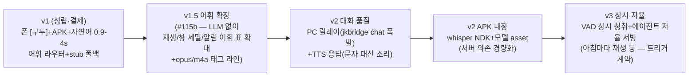

# 구두(OS) 조작 사례 수집+앞으로의 방향 (2026-10-26 — 사용자 지시)

> 사용자 지시: "이렇게 구두로 OS 조작하는 사례 수집해서 앞으로 가야할 방향에
> 대해 정리" — 실측 원문 = 각 라인의 as-built docs/원장(링크). 사례는
> **실기기 성립 원문만** 수집(추측 사례는 기대 사례로 분리).

## 1. 성립한 구두 조작 사례 (실측 원문)

| # | 사례 | 성립 근거 | 원문/원장 |
|---|---|---|---|
| S1 | **폰 [구두] 발화 → 앱 실행** — "지뢰찾기 켜줘"(발화) → 지뢰찾기 창 실행 | whisper 전사→ChatRouteTurn→launch_app·사용자 결제 "잘되네요" | docs/91 §7-E(b2ea2e7) |
| S2 | **채팅 자연어 → 창 제어** — "지뢰찾기 실행해줘"→Launch JSON·"창 목록"→list | 라우터 어휘 즉발(ollama 불요)·PC/WSL/폰 공통 | docs/80·84 |
| S3 | **폰 LLM 클라우드 자연어** — 라우터 비매치 발화→ollama cloud 턴 0.9-4s 완건 행동 JSON | CLI 렌더층 혼입진원 수형(--hidethinking/--nowordwrap)+opt-out 밸브 | docs/92 §6(ad9aa81) |
| S4 | **폰 APK(타이핑/dictate) → OS 조작** — APK 텍스트→POST /talk→창 실행 | 반입 md5 등호·Launch 원문 3런·사용자 "지뢰찾기 창은 실행됨" | docs/92(cce4420) |
| S5 | **에이전트 합성 입력** — send_input(캡처 폰 표면 취식 방어 재타·id=0 desk hit-test) | 프로브 폰 탭 원문 수백 건(#96·#99·#110·#111) | 각 probe 원장 |
| S6 | **에이전트 도구 OS 조작** — launch_app/close_window/focus_window/list_windows/capture_window/region · window_move/resize/minimize·trigger_toggle | 도구 허브 20종+·게이트 계약 | docs/57·80 |
| S7 | **사용 저널+수확** — 도구 1콜 1행 자동 기록+분류 요약 원문 | HARVEST-OK 4런·저널 지속성 봉인 | docs/90 §7.11 |
| S8 | **음악 구두 후보(재생계)** — spatial 재생 leg(vplayer 병행) — 구두 "음악 틀어줘"는 어휘 미매치(stub) | #91 leg WIRED | docs/90 §7.9-10 |

## 2. 기대 사례 (미성립 — 방향 결정 재료)

- **음악/미디어 구두**: "다음 곡"·"볼륨 줄여줘"·"재생/정지" — vplayer 도구(재생계) 가 원존이면 바로 어휘 확장 가능
- **창 세밀 조작**: "이 창 오른쪽으로 옮겨줘"·"반으로 줄여줘" — window_move/resize 도구 존재 — 자연어 인자 해석(LLM) 필요
- **파일/사진**: "어제 사진 보여줘" — gallery 도구+dirs
- **알림 읽기**: "알림 뭐 왔어" — notify 도구
- **TTS 응답** — 구두로 답듣기(v2 — 원존 비목표 승계)
- **APK 홈 위젯/상시 버튼**(구두 버튼 항상 위에 — v2)

## 3. 방향 정리 (단계 로드맵 — 제안)

- **v1.5(추천 다음)** — 조달 0·저위험·체감 증가 최대: 라우터 어휘 표 확장(S8 재생 음성 포함)+opus/m4a(이미 스펙 커밋). LLM 이슈(지연)와 무관하게 오프라인 조작 커버리지 늘림.
- **v2 대화 품질** — PC 릴레이(폰 발화→PC LLM)·TTS(폰이 듣는 답)·APK 내장 전사(서버 부재 시에도).
- **v3** — 상시 청취(VAD)+트리거/자율(#113 사이클의 자동화 심화) — 안전 게이트(권한·rate cap)와 함께.
- **운영 계약(불변)** — 결제=사용자 선언만·EYES 규약(§5.1)·원문 원장·캐논 등호·원자적 쓰기·fail-closed(구두/leg 끔+정직 표기).

## 4. 각 방향의 판정 기준 (체감 문턱)

| 방향 | 판정 기준 |
|---|---|
| 어휘 확장 | 사용자가 새 발화 → 즉발(0.2s 내) 창 동작 = 성공 |
| PC 릴레이 | 폰 발화→결과 3s 내+PC 부재 시 정직 폴백 |
| TTS | 폰에서 답을 들었을 때 지연 ≤1s+정직성 |
| APK 내장 | 폰 Termux 서버 부재에서도 전사 성립 |
| 상시 청취 | 오경동작(무발화 launch) 월 0건 수준 — 재판정 자리 |